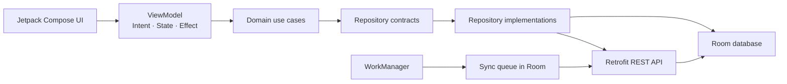

# FinanceApp

Android-приложение для управления личными финансами: расходы, доходы, счета и аналитика в одном интерфейсе.

Проект создан как portfolio pet project и демонстрирует не только UI на Jetpack Compose, но и полноценную архитектуру Android-приложения: offline-first хранение данных, фоновую синхронизацию, устойчивую работу с сетью, безопасный вход по PIN-коду и биометрии, локализацию и тестируемую бизнес-логику.

`Kotlin` · `Jetpack Compose` · `Material 3` · `Clean Architecture` · `Room` · `Retrofit` · `WorkManager` · `Hilt`

## Возможности

- учёт расходов и доходов с выбором счёта, категории, даты, времени и комментарием;
- создание, редактирование и удаление транзакций;
- управление финансовыми счетами, балансом и валютой;
- аналитика за выбранный период с круговой диаграммой и разбивкой по категориям;
- фильтрация аналитики по типу операции, периоду, категориям и счёту;
- работа с ранее загруженными данными без подключения к интернету;
- сохранение изменений offline с последующей автоматической синхронизацией;
- светлая, тёмная и системная темы;
- интерфейс на русском, английском, немецком, французском и испанском языках;
- защита приложения PIN-кодом и биометрией.

## Скриншоты

| Расходы | Доходы | Счета |
|:---:|:---:|:---:|
|  |  |  |

| Аналитика | Выбор периода | Детализация |
|:---:|:---:|:---:|
|  |  |  |

## Технические особенности

### Offline-first и синхронизация

Room используется как локальный источник данных для счетов, категорий и транзакций. Пользователь может продолжать работу без сети: изменения сразу сохраняются локально, а операции, требующие отправки на сервер, попадают в отдельную очередь синхронизации.

Синхронизация реализована через WorkManager:

- запускается при старте приложения и после восстановления подключения;
- повторяется в фоне каждые 2 часа при наличии сети;
- последовательно обрабатывает pending-операции;
- обновляет локальный snapshot после успешной отправки данных;
- разрешает конфликты по стратегии Last Write Wins;
- сообщает UI о неудачных операциях и позволяет повторить или отбросить их.

### Устойчивая работа с сетью

REST API подключён через Retrofit, OkHttp и Kotlinx Serialization. Сетевые вызовы проходят через единый executor, который:

- проверяет подключение до выполнения запроса;
- ограничивает запрос таймаутом в 15 секунд;
- повторяет временные ошибки сети, timeout и ответы сервера `500`;
- выполняет до трёх повторов с интервалом 2 секунды;
- преобразует ошибки data-слоя в понятные состояния UI.

При отсутствии подключения приложение использует локальный кэш и показывает offline-индикатор, не подменяя сетевые ошибки пустым экраном.

### Безопасность

PIN-код не хранится в открытом виде. Для проверки используется HMAC-SHA256:

- криптографический ключ создаётся и хранится в Android Keystore;
- для PIN генерируется индивидуальная соль;
- в DataStore сохраняются только соль и verifier;
- verifier сравнивается через `MessageDigest.isEqual`;
- после серии неудачных попыток включается временная блокировка;
- биометрический вход реализован через AndroidX Biometric.

### Presentation layer

Интерфейс полностью написан на Jetpack Compose и Material 3. Состояние экранов организовано в MVI-подобном стиле через `Intent`, `State` и одноразовые `Effect`. Повторно используемые элементы — bottom sheet, состояния загрузки и ошибок, списки, поля выбора и форматирование — вынесены в общие компоненты.

Настройки темы, валюты и параметры входа сохраняются в DataStore. Для навигации используется Navigation Compose, а зависимости предоставляются через Hilt.

## Архитектура

Проект разделён на `presentation`, `domain` и `data`. UI зависит от use case, а детали Room, Retrofit и синхронизации скрыты за repository-контрактами доменного слоя.



```text
app/src/main/java/com/example/financeapp/
├── core/           # тема, локализация, сеть, dispatchers
├── presentation/   # Compose UI, ViewModel, state, navigation
├── domain/         # модели, repository-контракты, use case
├── data/
│   ├── local/      # Room, DAO, entities, migrations
│   ├── network/    # Retrofit API, DTO, auth, retry
│   ├── offline/    # локальные pending-изменения
│   ├── repository/ # реализации repository
│   ├── security/   # PIN, Keystore, DataStore
│   └── sync/       # WorkManager и обработка очереди
└── di/             # Hilt-модули
```

## Стек

| Область | Технологии |
|---|---|
| Язык и UI | Kotlin, Coroutines, Flow, Jetpack Compose, Material 3 |
| Архитектура | Clean Architecture, Repository, Use Case, MVI-подобный presentation layer |
| Навигация и DI | Navigation Compose, Hilt, KSP |
| Локальные данные | Room, DataStore |
| Сеть | Retrofit, OkHttp, Kotlinx Serialization |
| Фоновые задачи | WorkManager |
| Безопасность | Android Keystore, HMAC-SHA256, AndroidX Biometric |
| Тестирование | JUnit, Coroutines Test, Compose UI Test, Espresso |

Текущая конфигурация проекта: Kotlin `2.0.21`, Android Gradle Plugin `8.13.2`, `minSdk 26`, `targetSdk 36`.

## Тестирование

В проекте есть unit-, integration- и instrumented-тесты. Основные сценарии покрытия:

- расчёты денежных значений и аналитики;
- use case для счетов и транзакций;
- маппинг network, local и domain-моделей;
- обработчики offline-синхронизации и разрешение конфликтов;
- reducers и ViewModel редактора транзакций;
- фильтры и мапперы аналитики;
- форматирование денежных значений;
- настройка темы и PIN-кода в Compose UI.

Полезные команды:

```bash
# Unit-тесты
./gradlew :app:testDebugUnitTest

# Компиляция instrumented-тестов
./gradlew :app:compileDebugAndroidTestKotlin

# Android Lint
./gradlew :app:lintDebug
```

Instrumented-тесты запускаются на подключённом устройстве или эмуляторе:

```bash
./gradlew :app:connectedDebugAndroidTest
```

### Appium UI/UX-тесты

Внешний набор Appium проверяет не отдельные клики, а законченные пользовательские задачи: насколько предсказуемо пользователь находит нужную функцию и видит результат действия. Это автоматизированная проверка интерфейса; для оценки реальной понятности и удовлетворённости она дополняется наблюдением и обратной связью живых пользователей.

Покрыты восемь сценариев:

1. Ориентация на первом экране и доступность основной навигации.
2. Поиск разделов расходов и доходов.
3. Переход к финансовым счетам.
4. Открытие аналитики из верхней панели.
5. Выбор темы и сохранение выбранного варианта.
6. Выбор и применение даты операции.
7. Отмена изменения даты операции.
8. Создание и подтверждение PIN-кода.

Тесты находятся в [`appium/`](appium/README.md) и используют Appium 2, UiAutomator2 и стабильные идентификаторы Compose `testTag`. Перед запуском нужны Node.js 20+, запущенный Android-эмулятор или подключённое устройство, debug APK и Appium Server:

```bash
cd appium
npm install
npx appium driver install uiautomator2
npx appium
```

Во втором терминале:

```bash
cd appium
npm run test:android
```

По умолчанию используется APK `app/build/outputs/apk/debug/app-debug.apk`. Для другого пути задайте переменную `FINANCE_APP_PATH`. Полные предусловия, включая настройку токена и backend для сценариев с редактором операции, описаны в [appium/README.md](appium/README.md).

## Запуск проекта

### Требования

- Android Studio с поддержкой Android SDK 36;
- JDK 17;
- устройство или эмулятор с Android 8.0 (API 26) и выше;
- токен доступа к backend API.

### Установка

1. Клонируйте репозиторий:

   ```bash
   git clone https://github.com/Nejas/FinanceApp.git
   cd FinanceApp
   ```

2. Откройте проект в Android Studio и дождитесь Gradle Sync.

3. Добавьте API-токен в локальный файл `local.properties`:

   ```properties
   SHMR_API_TOKEN=your_token_here
   ```

   `local.properties` исключён из Git, поэтому секрет не попадёт в репозиторий. Во время сборки значение передаётся в `BuildConfig` и используется Bearer-интерцептором. Без корректного токена backend вернёт `401 Unauthorized`.

4. Запустите приложение из Android Studio или соберите debug APK:

   ```bash
   ./gradlew :app:assembleDebug
   ```

   В Windows PowerShell используйте `.\gradlew.bat :app:assembleDebug`.

## Что демонстрирует проект

- проектирование Android-приложения с разделением ответственности между слоями;
- согласование локального и серверного состояния в offline-first сценариях;
- работу с конкурентными операциями, очередью изменений и конфликтами синхронизации;
- безопасное хранение данных для проверки PIN-кода;
- управление сложным Compose-состоянием без прямой зависимости UI от data-слоя;
- тестирование бизнес-логики, presentation-компонентов и интеграции с API.
